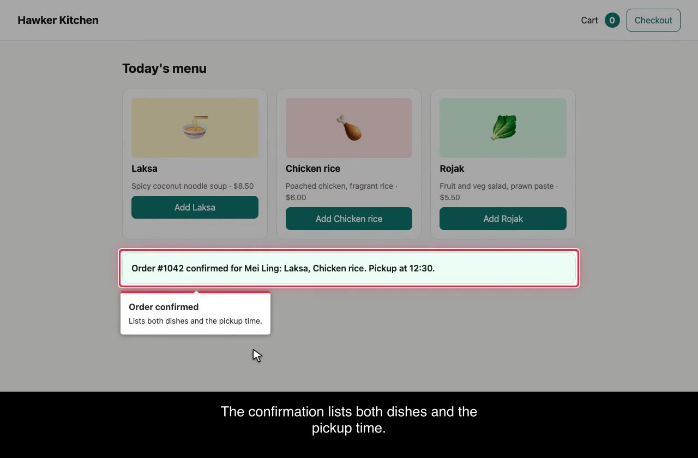
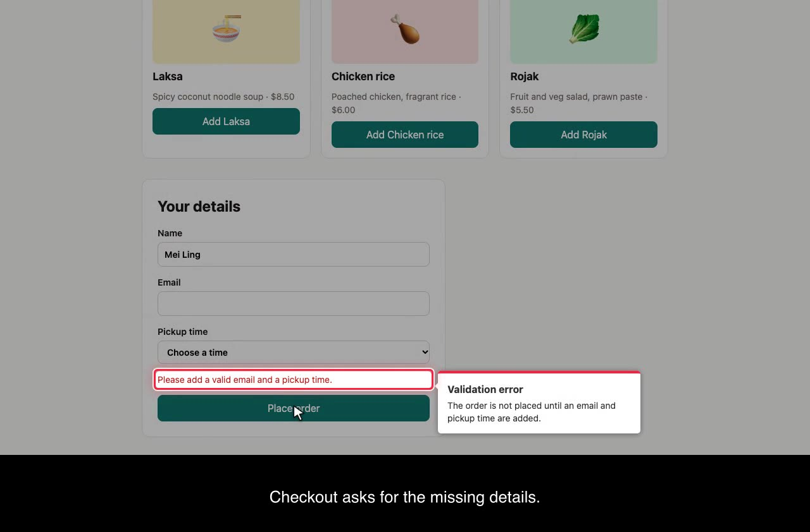

# uat-reel

**Storyboarded UAT videos for web apps.** Write a YAML storyboard and get back:

- an MP4 with **red-box highlights**, a visible cursor, chapter cards and **burned-in captions**;
- a review pack that lets a person or an AI agent check every frame against what should be on screen.

Built on [Playwright](https://playwright.dev) (actions and recording) and
[driver.js](https://driverjs.com) (spotlight and labels), with ffmpeg doing the captions.



- **Repeatable.** The video is a script, so you re-record it on every release with one command.
- **Evidence, not a demo.** `expect` steps are assertions. If the app misbehaves, the recording fails
  and `failure.png` shows the state.
- **Self-pacing captions.** The video waits until each caption has been on screen long enough to read
  (`chars / cps`), so you never hand-tune waits.
- **Reviewable without watching.** `review/REVIEW.md` pairs every extracted still with the caption and
  box that *should* be visible, so a reviewer, human or agent, can find mismatches.
- **Ships with an agent skill.** [`skills/uat-reel`](skills/uat-reel/SKILL.md) takes an agent (such as
  Claude Code) through Storyboard → Subtitles → Highlights → Record, with an independent adversarial
  review after each stage.

## Quick start

Requirements: Node 20+, and ffmpeg built with libass (`brew install ffmpeg` or `apt install ffmpeg`).

```bash
npm i -D uat-reel
npx playwright install chromium
npx uat-reel init uat/checkout.storyboard.yaml
npx uat-reel rehearse uat/checkout.storyboard.yaml   # fast, no video, screenshots of every box
npx uat-reel record uat/checkout.storyboard.yaml     # out/checkout/video.mp4 + review pack
```

To try the bundled example (a static page, no server needed):

```bash
git clone https://github.com/kwannoel/uat-reel && cd uat-reel
npm i && npx playwright install chromium && npm run build
node dist/cli.js record examples/demo.storyboard.yaml
```

## Storyboard

```yaml
title: Hawker Kitchen guest checkout
baseUrl: http://localhost:3000          # or omit and use paths relative to this file

acceptance:
  - id: AC3
    text: A complete order is confirmed with the dishes and pickup time

scenes:
  - id: confirm-order
    title: Place a complete order
    covers: [AC3]                        # lint fails if a criterion has no scene, or a scene no expect
    steps:
      - goto: /menu
        say: A guest opens the menu.     # caption cue starts here
      - fill: role=textbox[name="Email"]
        value: meiling@example.com
        say: They add an email address.
      - select: role=combobox[name="Pickup time"]
        value: "12:30"
        box: Pickup time                 # red box + label before acting (true = box without label)
      - click: role=button[name="Place order"]
        box: true
      - expect: role=status              # assertion: fails the recording if it isn't met
        text: Pickup at 12:30
        box: Order confirmed
        note: Lists both dishes and the pickup time.
        say: The confirmation lists both dishes and the pickup time.
```

**Actions** (one per step): `goto`, `click`, `fill` + `value`, `press` (+ `on`), `select` + `value`,
`check`, `uncheck`, `hover`, `scroll`, `waitFor`, `wait` (ms), `expect` (+ `text`, or `hidden: true` to
wait for the target to disappear), `highlight`,
`capture` + `as` (+ `pattern`). A step with only `say` is a narration beat.

**Modifiers:** `say` (caption), `box` (red box, with an optional label), `note` (popover text),
`pause` (extra ms), `secret` (on `fill`; see below), `offCamera` (run without recording).

**Targets** are [Playwright selectors](https://playwright.dev/docs/other-locators). Prefer
`role=…[name="…"]`, `text=…` and `[data-testid=…]`. Lint warns on brittle CSS.

**Environment variables:** any string can use `${NAME}` or `${NAME:-fallback}`; write `$${` for a
literal `${`. If a variable is unset and has no fallback, the storyboard is rejected and every missing
name is listed. This keeps environment-specific URLs and test credentials out of the committed file:

```yaml
baseUrl: ${UAT_BASE_URL:-http://localhost:3000}
steps:
  - fill: role=textbox[name="Email"]
    value: ${UAT_EMAIL}
  - fill: role=textbox[name="Password"]
    value: ${UAT_PASSWORD}
    secret: true    # must be a single ${VAR}; refuses to run unless the field is type=password
```

### Several people, captured values and off-camera work

A flow that crosses people or apps (a buyer orders in a shop, a supplier refunds it in a back office)
uses **actors**. Each actor is its own browser session for the whole run, and every scene names one:

```yaml
actors:
  buyer:
    baseUrl: ${SHOP_URL}
    signIn:                                # runs off camera before the buyer's first scene
      - goto: /sign-in
      - fill: role=textbox[name="Email"]
        value: ${BUYER_EMAIL}
      - fill: "[data-testid=password]"
        value: ${BUYER_PASSWORD}
        secret: true
      - click: role=button[name="Sign in"]
  supplier:
    baseUrl: ${ERP_URL}
    storageState: supplier.json            # or a saved session

setup:                                     # before every rehearse and record; no shell
  - [npm, run, db:reset]

scenes:
  - id: order
    title: The buyer orders
    actor: buyer
    steps:
      - click: role=button[name="Place order"]
      - capture: "[data-testid=order-number]"   # stored for later steps
        as: order
  - id: accept
    title: The supplier accepts
    actor: supplier
    offCamera: true                        # moves the app along; not in the video
    steps:
      - click: role=link[name="{{order}}"]
  - id: refund
    title: The supplier refunds
    actor: supplier
    steps:
      - goto: /orders
        offCamera: true                    # this step only
      - click: role=button[name="Refund {{order}}"]
        say: The supplier refunds {{order}}.
```

- `capture` stores an element's text, or a form field's value. `pattern` keeps the first group of a
  regular expression. `{{name}}` inserts it into any later string. Lint rejects a name used before it
  is captured.
- Waits on the app longer than `pacing.cutAfter` (default 1000 ms) become **jump cuts**, listed in
  `manifest.json` and `REVIEW.md`.
- `record --from <scene>` replays the earlier scenes unrecorded to rebuild app state and captures,
  re-records that scene and every later one, and reuses the earlier scenes' saved segments. It needs
  `setup` (or `--no-setup` to replay on the current state).

[`examples/market.storyboard.yaml`](examples/market.storyboard.yaml) shows all of this against a small
two-role app in `examples/market-app/`.

**Settings** (all optional, defaults shown):

```yaml
viewport: { width: 1280, height: 720 }
storageState: auth.json                # Playwright storage state for a signed-in session
captions: { cps: 15, minMs: 1500, maxLineChars: 42, maxLines: 2, band: true }
pacing:   { afterAction: 500, boxHold: 1200, typeDelay: 45, cursorMs: 450, tail: 1000, cutAfter: 1000 }
style:    { boxColor: "#ff1f3d", boxWidth: 3, boxPadding: 3, dim: 0.35, cursor: true, chapters: true, sceneChip: false }
```

`npx uat-reel schema` prints the JSON Schema. Add
`# yaml-language-server: $schema=https://unpkg.com/uat-reel/schema.json` to the top of a storyboard to
get completion in your editor.

## Commands

| Command | What it does |
|---|---|
| `uat-reel init <file>` | Write a starter storyboard |
| `uat-reel lint <storyboard>` | Check the schema and authoring rules: coverage, caption length, box targets, brittle selectors |
| `uat-reel rehearse <storyboard>` | Run with no video and short holds, screenshotting every box and expect into `shots/` |
| `uat-reel record <storyboard>` | Record and post-process (below) |
| `uat-reel review-pack <out-dir>` | Rebuild `review/` from an existing recording |
| `uat-reel schema` | Print the storyboard JSON Schema |

Options: `--out <dir>`, `--base-url <url>`, `--headed`, `--timeout <ms>`, `--no-post`,
`--from <scene>` (record), `--no-setup`, `--dir <folder>` (where setup runs and relative paths
resolve; default the storyboard's folder).

Every take writes `reproduce.sh`, which reruns the whole film from the output folder:
`bash out/<name>/reproduce.sh`. It exports the variables the take used, except secrets, which you set
first. See [design](docs/design.md#reproduce-script).

The exit code is 0 on success, 1 when a step or `expect` fails (the video is still written), and 2 for
usage errors or an invalid storyboard.

## Output

```
out/<name>/
  video.mp4          captions burned into a black band under the page
  video.clean.mp4    no burned captions; soft subtitle track
  captions.srt/.vtt  sidecars
  raw.mp4            recorded segments joined, before captions
  scenes/            each scene's segments and events, reused by record --from
  manifest.json      every scene, cue, box and expect with timestamps
  reproduce.sh       reruns this take: same storyboard, options, environment and tool version
  storyboard.yaml    the storyboard as run
  failure.png        only when a step failed
  review/
    REVIEW.md        expected vs actual for every still, plus expects and timing checks
    frames/          chapter-NN, cue-NN (caption midpoints), box-NN (just after each box appears)
    contact-NN.jpg   4×4 grids, one tile every 2 s, timestamped
```



## The agent skill

[`skills/uat-reel/SKILL.md`](skills/uat-reel/SKILL.md) is a plain skill folder. Copy it into
`.claude/skills/` (Claude Code) or wherever your agent loads skills from:

```bash
cp -r node_modules/uat-reel/skills/uat-reel .claude/skills/
```

It runs four stages, with a gate after each one:

| Stage | Author does | Gate reviewer gets |
|---|---|---|
| 1. Storyboard | scenes, actions, `expect`s; `lint` + `rehearse` | YAML, criteria, rehearse shots: [brief](skills/uat-reel/reviewers/storyboard.md) |
| 2. Subtitles | `say:` lines | YAML, criteria, lint output: [brief](skills/uat-reel/reviewers/captions.md) |
| 3. Highlights | `box:` / `note:` / `highlight:` | rehearse shots + manifest: [brief](skills/uat-reel/reviewers/highlights.md) |
| 4. Record | `record` | review pack: [brief](skills/uat-reel/reviewers/video.md) |

Each gate starts a **fresh** reviewer subagent. It gets the artifacts and an adversarial brief, never
the author's reasoning. It returns `PASS` or `BLOCK` with evidence-backed findings. Blockers get
fixed, a new reviewer re-reviews, and after three rounds the question goes to a human. Every verdict
is logged in `uat/<slug>.reviews.md`.

## Library

```ts
import { run, loadStoryboard, lint } from "uat-reel";

const { manifest } = await run({ storyboard: "uat/checkout.storyboard.yaml", out: "out/checkout", mode: "record" });
if (!manifest.ok) throw new Error(manifest.error?.message);
```

## Limitations

- The recording browser runs with `bypassCSP`, so the overlay works on apps with a strict
  Content-Security-Policy. This affects only the recording browser, never your app.
- Chromium only.
- No voice-over.
- One box at a time (use consecutive `highlight` steps instead).
- Caption timestamps come from wall-clock time measured against the start of the screencast. They're
  accurate to roughly one frame, which is fine for captions but not for frame-exact editing.

See [docs/design.md](docs/design.md) for the design.

## License

MIT
